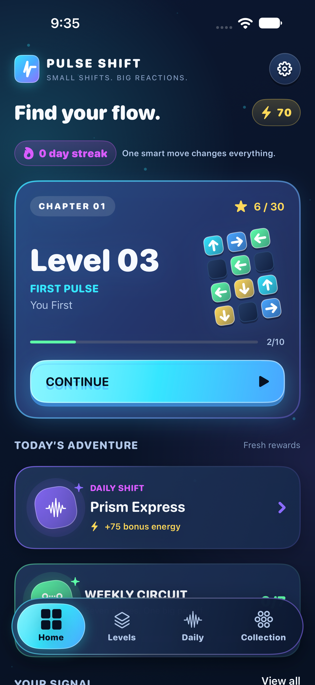
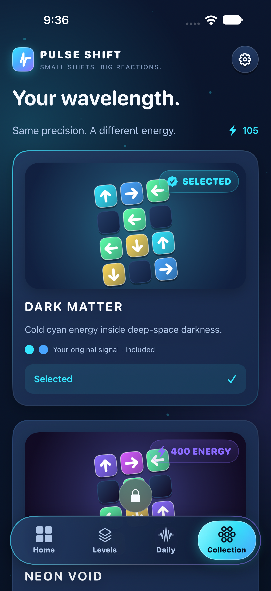
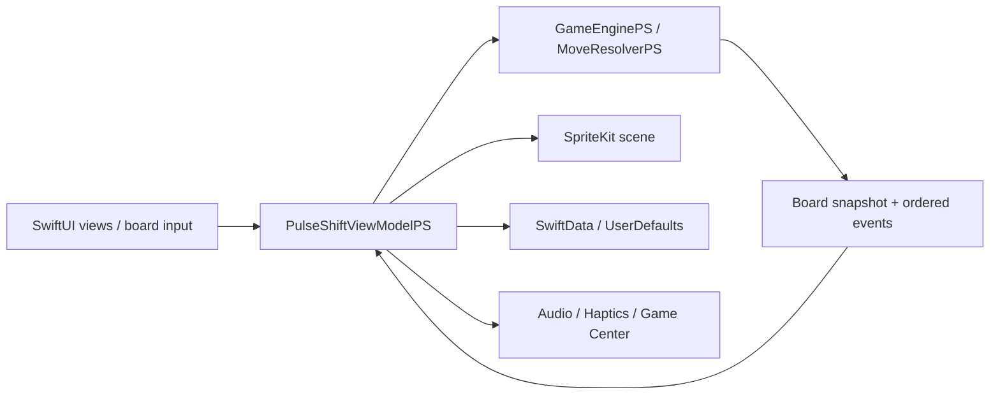

<p align="center">
  
</p>

<h1 align="center">PULSE SHIFT</h1>

<p align="center">A native iPhone puzzle game about directional signals, careful sequencing, and chain reactions.</p>

<p align="center">
  
  
  
  
  
</p>

## Demo

**YouTube demo: [▶ Watch the demo on YouTube](https://www.youtube.com/shorts/XfiTljspBsM)**

## Overview

Pulse Shift is a personal iOS project for players who enjoy spatial logic and planning the order of their moves. Tap a directional pulse to send it across a grid, clear its route, and connect mechanisms that can trigger a larger reaction.

The game contains 60 bundled puzzles across six chapters: **First Pulse, Vector, Circuit, Phase, Polarity, and Overload**. Campaign progression, challenge results, cosmetic unlocks, and preferences are stored locally. Core gameplay works offline without an account or backend.

## Key Features

- **Progressive campaign:** six chapters of ten levels, sequential unlocks, tutorial tips, and replayable levels with saved best results.
- **Connected mechanics:** walls, redirects, rotators, switches and gates, portals, breakable crystals, dormant pulses, cores, reactors, and magnetic polarity changes.
- **Explicit objectives:** clear pulses, destroy crystals, activate reactors, or use portal pairs, depending on the level. Selected puzzles also have move limits.
- **Recoverable attempts:** full-state undo, restart, highlighted hints, pause/resume, and recovery actions when no route remains.
- **Stars and Perfect Shifts:** one to three stars based on moves versus par; a Perfect Shift requires finishing at or below par without hints or undo.
- **Daily Shift and Weekly Circuit:** a date-selected daily puzzle with a streak history, plus seven sequential weekly stages. Both reuse bundled campaign levels and calculate their selection locally.
- **Earned customization:** five board color themes, with additional themes unlocked using Pulse Energy earned through play.
- **Progress tracking:** chapter stars, eight local achievement goals, chain records, streaks, and gameplay statistics.
- **Feedback controls:** separate sound, music, haptics, tutorial-tip, and Reduced Effects settings, with system Reduce Motion support and accessible board controls.

### Puzzle rules

An active pulse travels in its arrow direction until it leaves the board or reaches a blocker. Other pulses block its path. An unchanged blocked tap is free; partial movement or crystal damage consumes a move. A crystal stops the pulse even on the hit that destroys it.

Redirectors and rotators turn pulses. Linked switches toggle gates or wake dormant pulses. Cores emit four rays, while reactors emit their configured directions. Rays stop at the first obstacle or interactable; awakened pulses launch after the triggering pulse finishes. Each reactor emits at most once per player move, and each switch receives at most one activation per move. One-shot switches retain their used state across moves.

Portals preserve direction unless configured to rotate it. Polarity switches flip linked magnets: opposite signs attract and matching signs repel by one cell within the configured axis and range. Magnetic proposals share one board snapshot; occupied destinations, conflicting instructions, and duplicate destinations remain stationary. Magnetic shifts do not automatically launch pulses or activate tiles.

Undo restores the logical board snapshot, but hint and undo usage remain recorded for that attempt. Restart begins a fresh attempt. Par is an authored target, not a proven shortest solution.

## Screenshots

<table>
  <tr>
    <th>Home &amp; campaign progress</th>
    <th>Collection &amp; earned themes</th>
  </tr>
  <tr>
    <td></td>
    <td></td>
  </tr>
</table>

<!-- Add current screenshots of a gameplay board, a Perfect Shift result, Daily Shift, and Weekly Circuit. Older gameplay screenshots in Documentation/Screenshots predate the current interface and campaign revision. -->

## Tech Stack

| Technology | Purpose in this project |
| --- | --- |
| Swift | Value-type level and board models, movement resolution, scoring, challenge selection, and application logic. The app target uses Swift 5 language mode. |
| SwiftUI | App lifecycle, Home/Levels/Daily/Collection screens, settings and modal navigation, gameplay HUD, completion overlays, and a board accessibility representation. |
| Observation | `@Observable` models expose session state, settings, persistence state, and Game Center status. Views consume the app model through the environment and create bindings with `@Bindable`. |
| Combine | `ObservableObject` and `@Published` drive the completion screen's staged stars and energy reveal, owned by `@StateObject`. |
| SpriteKit | Renders the interactive grid and animates ordered engine events through `SKScene`, `SKNode`, and `SKAction`, embedded with `SpriteView`. |
| SwiftData | Persists level/challenge records and player progression, including energy, unlocked themes, achievements, and statistics. |
| Foundation / Codable / UserDefaults | Decodes six bundled JSON chapter files, computes calendar-based challenges, and persists small preferences and the first-launch flag. |
| AVFAudio / Dispatch | Plays bundled WAV effects and a looping ambient track through `AVAudioPlayer`; a dedicated serial queue confines playback state. |
| Core Haptics | Supplies event-specific tactile patterns, with UIKit feedback-generator fallbacks where needed. |
| GameKit | Optional Game Center authentication, dashboard presentation, achievement reporting, and a Perfect Clears leaderboard submission. Apple service configuration is required. |
| XCTest / XCUITest / Swift Package Manager | Provides a separate macOS package for engine/persistence tests and an Xcode UI test target for application flows. |

The app uses Apple frameworks only. There are no third-party package products or CocoaPods dependencies. There is no custom HTTP client or application backend; optional online integration goes through GameKit. Analytics calls use a no-op implementation. The mock advertising service is a scaffold, not a working ad feature, and is not connected to gameplay.

## Architecture

The implementation follows **MVVM with a separate game engine and rendering layer**. One app-scoped, `@MainActor` `PulseShiftViewModelPS` coordinates routing, game sessions, progression, and services. SwiftUI views render its state and send actions back to it. The app owns the observable model with `@State` and injects it into the environment.

A board tap reaches the ViewModel from SpriteKit or the SwiftUI accessibility controls. The ViewModel asks `GameEnginePS` to resolve it. `MoveResolverPS` calculates the final value-type `BoardStatePS` and ordered events without SpriteKit or physics. The ViewModel publishes the board state, asks the scene to animate those events, then evaluates completion or failure after presentation finishes. Animation does not determine game rules.



Navigation is state-driven: `tab` switches the four main sections, `selectedChapter` selects a level grid, and `currentLevel` presents gameplay. An identifiable sheet route opens settings, statistics, the weekly circuit, and debug tools. Settings uses a `NavigationStack` for legal pages. Game Center controllers are bridged into SwiftUI through `UIViewControllerRepresentable`.

## Project Structure

| Path | Responsibility |
| --- | --- |
| `Pulse Shift/Models/` | Codable level definitions, board snapshots, scoring, progression, settings, and SwiftData models. |
| `Pulse Shift/ViewModels/` | Application/session coordination and completion-reveal presentation state. |
| `Pulse Shift/Views/` | Main sections, gameplay controls and overlays, settings, legal pages, and DEBUG tools. |
| `Pulse Shift/Gameplay/Engine/` | Movement, interaction resolution, undo, hints, level loading, and solution validation. |
| `Pulse Shift/Gameplay/Scene/` | SpriteKit board layout, entity geometry, texture fallbacks, and event animation. |
| `Pulse Shift/Services/` | Persistence, audio, haptics, and Game Center integration. |
| `Pulse Shift/DesignSystem/` | Shared colors, themes, buttons, cards, and optional artwork hooks. |
| `Pulse Shift/Data/`, `Audio/`, `Assets.xcassets/` | Bundled campaign JSON, 14 WAV files, app icon, colors, and artwork slots. |
| `Config/` | App Info.plist and Game Center entitlement. |
| `Tests/`, `PulseShiftUITests/` | Package-level XCTest suites and app UI flows. |
| `Scripts/`, `Documentation/` | Authored-level generation, campaign audit, asset specifications, screenshots, and historical verification notes. |

## Getting Started

### Requirements

- macOS with Xcode and an iOS SDK capable of opening this project's configuration.
- An existing iPhone simulator with iOS 17 or later, or a physical iPhone running iOS 17 or later.
- The app is configured for **iPhone, portrait orientation**; iPad, Mac Catalyst, and Mac execution are not enabled for the app target.
- The local toolchain inspected for this documentation is **Xcode 27.1 / Apple Swift 6.4**. This records the available tools, not a verified minimum Xcode version or a successful build.

### Run the app

1. Download or clone the project and open `Pulse Shift.xcodeproj` in Xcode.
2. Select the shared **Pulse Shift** scheme.
3. Choose an already installed compatible iPhone simulator and run with **Product → Run**.
4. For a physical device, select your own development team and an appropriate bundle identifier under Signing & Capabilities.

No dependency installation, environment file, API key, or content-generation step is needed for local gameplay. The root `Package.swift` is a separate engine test harness, not the iOS app entry point. It declares Swift tools 5.9 and macOS 14 or later, with no external dependencies.

### Optional Game Center setup

The target declares the Game Center capability and entitlement. For authenticated reporting, enable Game Center for your App ID and configure the achievement and leaderboard identifiers used by `GameCenterServicePS` in App Store Connect. Gameplay remains available when authentication is unavailable. Authenticated reporting and physical-device haptics still require validation with your Apple configuration and hardware.

### Tests and developer tools

Run the engine, content, scoring, preferences, calendar, animation-ordering, and persistence suites from the repository root on macOS 14 or later:

```sh
swift test
```

The shared Xcode scheme includes UI tests for tutorial completion, undo/restart, progression after relaunch, finale mechanics, settings/legal navigation, and challenge entry/reset flows. Run **Product → Test**, or first inspect installed destinations and reuse an available simulator UUID:

```sh
xcrun simctl list runtimes
xcrun simctl list devices available
xcodebuild -project 'Pulse Shift.xcodeproj' -scheme 'Pulse Shift' \
  -destination 'platform=iOS Simulator,id=<existing-device-UUID>' \
  -parallel-testing-enabled NO test
```

DEBUG UI tests use an isolated local store and preference suite. Settings exposes DEBUG-only tools for unlocking levels, inspecting IDs/coordinates and FPS, and validating bundled solutions.

Builds and tests were **not run for this documentation update**. Existing results and their historical scope are recorded in [Verification](Documentation/Verification.md); they are not a fresh validation of the current checkout.

## Technical Highlights

1. **Deterministic resolution and complete undo snapshots.** The engine separates logical outcomes from visual timing. Its interaction queue limits repeated switch/reactor activations and rejects resolution overflow.
2. **Event-aware animation.** `MoveAnimationPS` merges consecutive straight movement while retaining portal transitions, turns, and simultaneous event groups. Feedback cues follow scene presentation events.
3. **Content validation before play.** Each bundled level is decoded, checked for invalid references and geometry, and replayed through its stored solution. Invalid records are excluded while valid levels remain available. See the [campaign audit](Documentation/CampaignAudit.md) for authored content details.
4. **Revision-aware progression and rewards.** Records track content revisions; current-revision scores drive stars while historical records preserve level access. Rewards distinguish first clears, campaign improvements, and already-rewarded daily/weekly replays.
5. **Accessible input alongside SpriteKit rendering.** SwiftUI supplies labeled board controls with matching grid positions. Reduced Effects and system Reduce Motion suppress selected shakes, particles, and large reveal effects; backgrounding pauses gameplay and audio.

## Limitations

- Completed results and preferences persist, but an unfinished board and its undo history are held in memory and are not restored after termination. There is no implemented cloud sync or cross-device progression.
- Daily and weekly selections depend on the device's calendar and clock. They are local rotations of existing levels, not server-delivered or newly generated puzzles.
- Most optional artwork slots are empty. The current app uses programmatic SwiftUI/SpriteKit artwork and SF Symbols, plus an existing app icon and bundled audio. See the [asset specification](Documentation/AssetSpecification.md) for planned artwork; its inventory is not a list of shipped images.
- Difficulty, accessibility, physical-device performance, and Apple service integration need release validation. A requested rendering rate is not a measured performance result.
